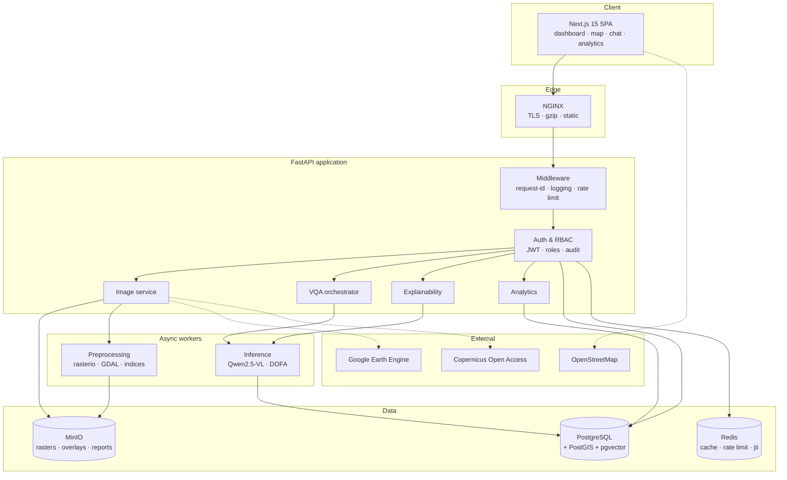
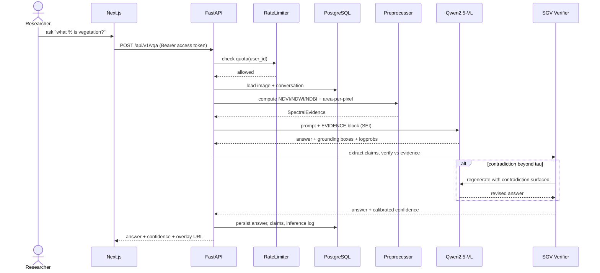
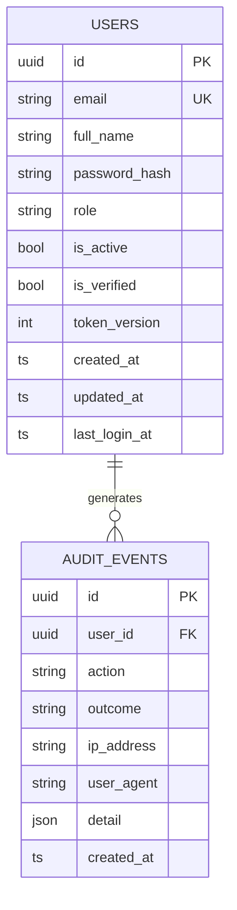
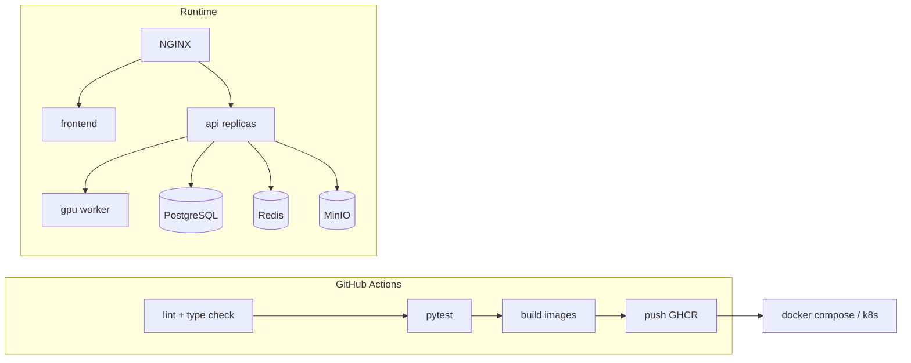

# GeoVisionGPT — System Architecture

## 1. Architectural style

**Clean Architecture** with four concentric layers. The dependency rule is absolute: source-code
dependencies point *inward only*.

```
          ┌─────────────────────────────────────────────┐
          │  api/          FastAPI routers, DI wiring    │  ← frameworks
          │  ┌───────────────────────────────────────┐  │
          │  │ infrastructure/  SQLAlchemy, Redis,   │  │  ← adapters
          │  │                  MinIO, torch, GDAL   │  │
          │  │  ┌─────────────────────────────────┐  │  │
          │  │  │ application/  use-case services  │  │  │  ← use cases
          │  │  │  ┌───────────────────────────┐   │  │  │
          │  │  │  │ domain/  entities, enums, │   │  │  │  ← enterprise rules
          │  │  │  │          Protocols        │   │  │  │
          │  │  │  └───────────────────────────┘   │  │  │
          │  │  └─────────────────────────────────┘  │  │
          │  └───────────────────────────────────────┘  │
          └─────────────────────────────────────────────┘
```

**Enforced invariants** (checked by `tests/test_architecture.py`):

- `app/domain/**` imports nothing from `sqlalchemy`, `fastapi`, `redis`, or `torch`.
- `app/application/**` imports nothing from `sqlalchemy`, `fastapi`, or `redis`.
- Interfaces are declared as `typing.Protocol` in the domain; concrete classes live in
  `infrastructure` and are bound to routes in `api/deps.py`, which is the composition root.

This is what makes the "swap the VLM backend" and "swap Postgres for SQLite" claims real rather than
aspirational — nothing above `infrastructure` knows either exists.

## 2. High-level architecture



## 3. Module → layer mapping

| # | Module | Domain | Application | Infrastructure | API |
|---|---|---|---|---|---|
| 1 | Authentication | `User`, `Role`, `AuditEvent` | `AuthService`, `AuditService` | SQLAlchemy repos, Argon2, JWT, Redis | `/api/v1/auth`, `/api/v1/users` |
| 2 | Image management | `SatelliteImage`, `ImageMetadata` | `ImageService` | MinIO, rasterio reader | `/api/v1/images` |
| 3 | Preprocessing | `PreprocessingRecipe`, `SpectralEvidence` | `PreprocessingService` | GDAL, OpenCV, NumPy | `/api/v1/preprocess` |
| 4 | Feature extraction | `FeatureMap` | `FeatureService` | Qwen ViT, DOFA | internal |
| 5 | Question understanding | `Question`, `Conversation` | `ConversationService` | tokenizers | `/api/v1/chat` |
| 6 | Fusion | `FusionContext` | `FusionService` (SEI) | backend adapters | internal |
| 7 | Answer generation | `Answer`, `Claim`, `Confidence` | `AnswerService` (CEV) | inference backends | `/api/v1/vqa` |
| 8 | Explainable AI | `Attribution` | `ExplainabilityService` | Grad-CAM, attention rollout | `/api/v1/explain` |
| 9 | GIS visualisation | `Layer`, `Geometry` | `LayerService` | GeoPandas, PostGIS | `/api/v1/gis` |
| 10 | Analytics | `MetricSnapshot` | `AnalyticsService` | SQL aggregation | `/api/v1/analytics` |

## 4. Repository layout

```
geovision-gpt/
├── docs/                       architecture, VLM study, research contribution, SRS, UML
├── backend/
│   ├── app/
│   │   ├── core/               config, logging, security primitives, errors
│   │   ├── domain/             entities, enums, Protocols   (zero framework imports)
│   │   ├── application/        use-case services, DTOs
│   │   ├── infrastructure/     db/, cache/, storage/, ml/
│   │   └── api/                deps.py (composition root), middleware, v1/ routers
│   ├── alembic/                migrations
│   └── tests/                  unit, integration, architecture
├── frontend/                   Next.js 15 (Module 2 onward)
├── ml/                         research notebooks, eval harness, SGV experiments
├── infra/                      docker-compose, nginx, k8s
└── scripts/                    dev tooling (PowerShell + shell)
```

## 5. Sequence — authenticated VQA request (target state)



## 6. Authentication sequence (Module 1 — implemented)

```mermaid
sequenceDiagram
    actor U as User
    participant API as FastAPI
    participant RL as RateLimiter
    participant AS as AuthService
    participant UR as UserRepository
    participant TS as TokenService
    participant AU as AuditService

    U->>API: POST /auth/login {email, password}
    API->>RL: hit("login:<ip>")
    RL-->>API: allowed
    API->>AS: authenticate(credentials)
    AS->>UR: get_by_email(email)
    UR-->>AS: User | None
    AS->>AS: Argon2 verify (constant-time; dummy hash if user absent)
    alt invalid
        AS->>AU: record(LOGIN_FAILED)
        AS-->>API: InvalidCredentialsError
        API-->>U: 401
    else valid
        AS->>TS: issue access + refresh (jti stored)
        AS->>AU: record(LOGIN_SUCCESS)
        AS-->>API: TokenPair
        API-->>U: 200 + tokens
    end
```

## 7. ER diagram — Module 1 slice



`token_version` is the revocation lever: bumping it invalidates every outstanding refresh token for
that user without needing a database-backed token table.

## 8. Deployment



## 9. Local development profiles

| Profile | Database | Cache | Storage | Requires |
|---|---|---|---|---|
| `local-lite` (**current**) | SQLite (aiosqlite) | in-memory | local filesystem | nothing extra |
| `local-full` | PostgreSQL 16 | Redis 7 | MinIO | Docker Desktop |
| `production` | managed Postgres + PostGIS | managed Redis | S3-compatible | cloud |

Profile is selected purely by environment variables; no code changes.
